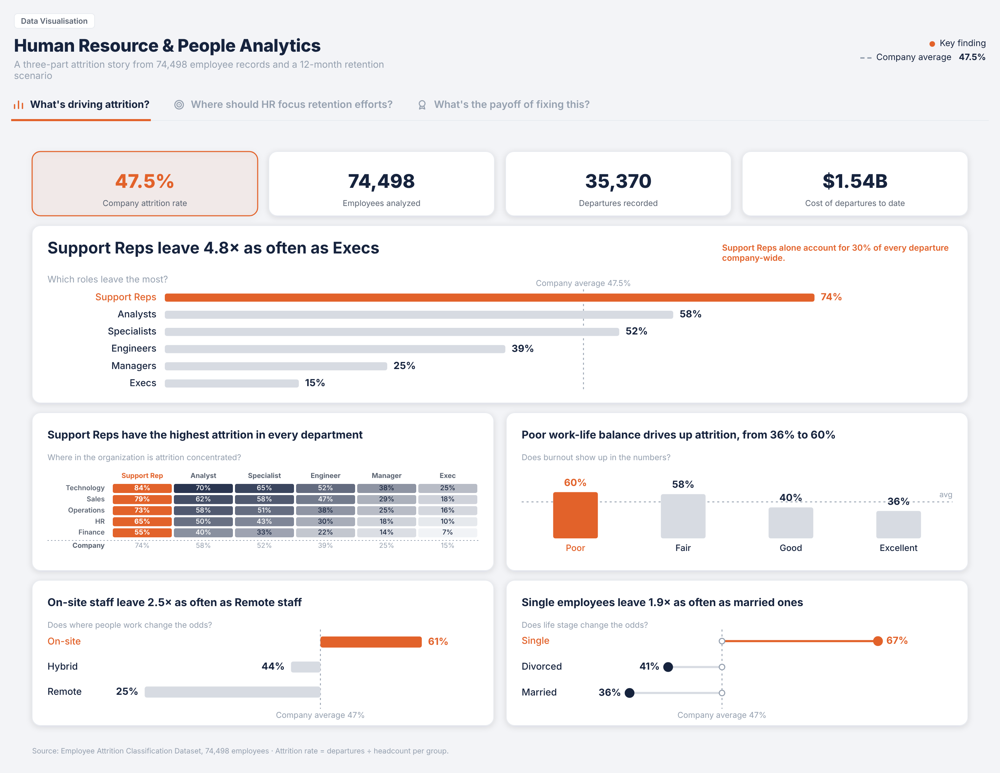
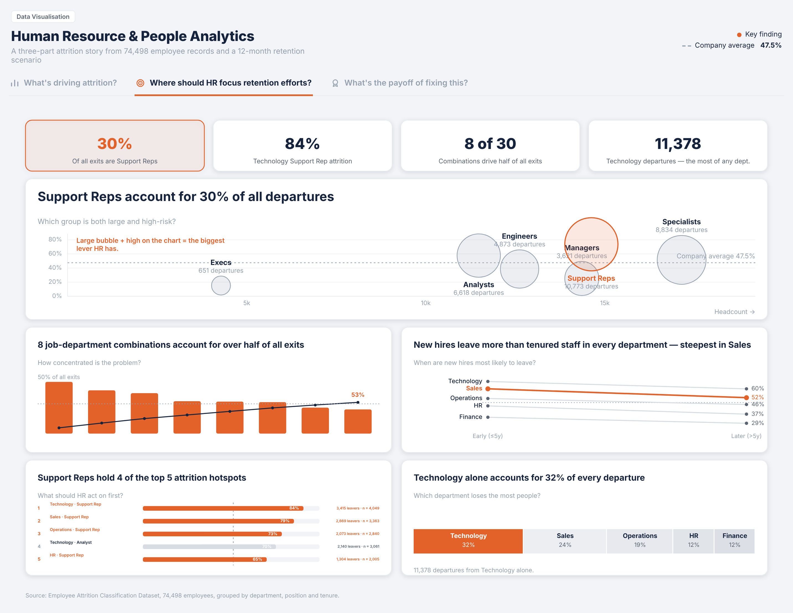
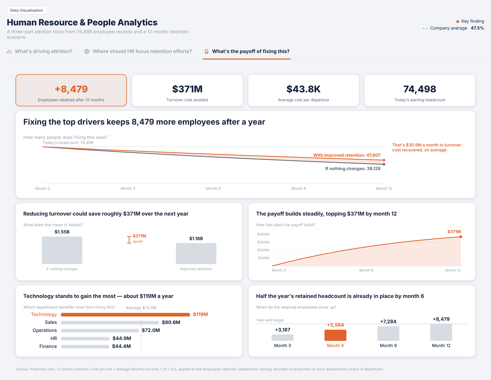

# Human Resource & People Analytics

A three-part dashboard story on employee attrition: what drives it, where HR should focus, and what fixing it is worth.

**🔗 [View the live dashboard](https://dimitris-angelides.github.io/hr-attrition-dashboard/)**

## The story

| Dashboard | Question |
|---|---|
| 1 | What's driving attrition? |
| 2 | Where should HR focus retention efforts? |
| 3 | What's the payoff of fixing this? |

## How to read it

- **Orange** marks the key finding in each chart
- **Dashed line** shows the company average
- **Titles** state the answer, and subtitles state the question

## Data

- Employee Attrition Classification Dataset (74,498 employees)
- 12-month retention projection (status quo vs improved scenario)
- Cost assumption: each exit costs half a year's salary

## About this project

Built with Claude as a comparison with the same story built in Tableau Public.

Feel free to explore the Tableau version: [here](https://public.tableau.com/app/profile/dimitris.angelides/viz/HumanResourcePeopleAnalytics/Drivers)
